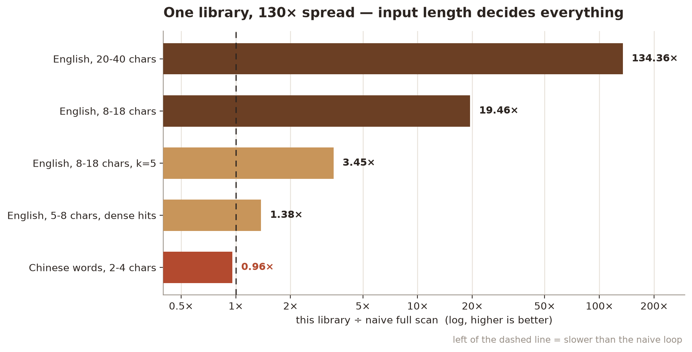
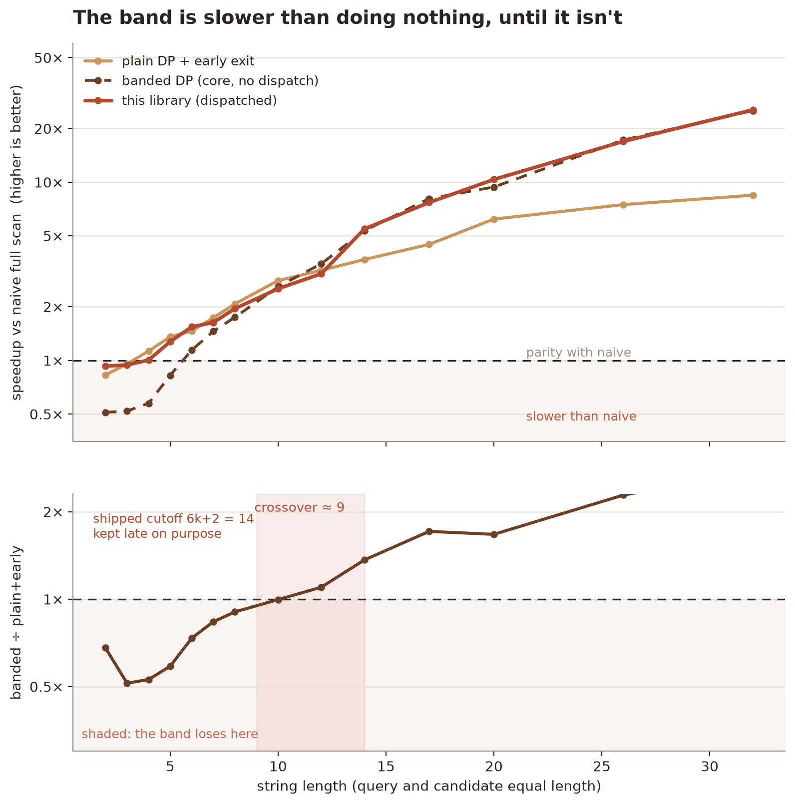
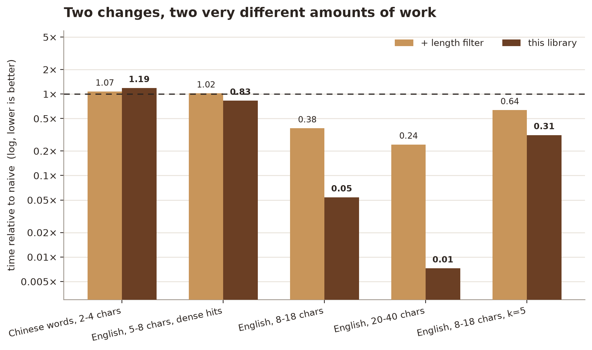

# Fast Fuzzy Search

Thresholded Levenshtein lookup over a list of strings, in pure Python with no
third-party runtime dependencies. Unicode included.

The point of the project is that **the textbook optimization is not uniformly
faster**. Banded DP — only computing the diagonal strip within distance `k` — is
a large win on long strings and a **net loss** on short ones, Chinese word
lookup among them. This library picks the right algorithm per call instead of
assuming.



## What it does

```python
from fast_fuzzy import search

choices = ["python", "pytorch", "java", "javascript", "pythonic"]
for m in search("pyhton", choices, max_distance=2, limit=5):
    print(m.value, m.distance, round(m.score, 1))
```

- `search()` — ranked matches, deterministic tie-breaking. Once `limit` results
  are held it tightens its working threshold to the current k-th distance, which
  prunes exactly (identical output, not approximate). The gain is modest —
  1.2-1.3× on long strings, lost in the noise on short ones — because the
  candidates it skips were already cheap.
- `search_dict()` — same, as plain dicts for JSON/API responses
- `levenshtein_bounded(a, b, k)` — distance if `<= k`, else `None`
- `levenshtein_reference(a, b)` — unbounded distance, used by the tests

## Three algorithms, one entry point

`levenshtein_bounded` dispatches on `m = min(len(a), len(b))`:

| condition | algorithm | time | memory |
|---|---|---|---|
| `m <= 3` | plain two-row DP | `O(n*m)` | `O(m)` |
| `m < 6k + 2` | plain DP + row-min early exit | `O(n*m)` worst, exits early | `O(m)` |
| otherwise | banded DP, width `2k+1` | `O(k*n)` | `O(k)` |

`n = max(len(a), len(b))`. The branch points are measured, not guessed.

## Why the band needs a dispatcher

A band reduces the cell count but raises the cost of each remaining cell: three
index computations, two boundary tests, three `min` arguments. On a 3-character
string it saves almost nothing and costs roughly 2× — it is *slower than the
naive loop it replaces*. The two effects cross over around 9-14 characters.



Above: speedup relative to the naive scan, so the curves are comparable across
machines. Below: the band's cost relative to plain DP with early exit, which is
the arm it actually has to beat.

## Measured behaviour

Five scenarios, 4,000 candidates per arm, best-of-N, arms interleaved per round,
ratios are per-round medians. A = naive full DP, B = A + length filter,
C = this library.

| case | hits | B/A | C/B | C/A |
|---|---|---|---|---|
| Chinese 2-4 chars, k=2 | 23 | 0.97× | 0.99× | 0.96× |
| English 5-8, k=2, dense hits | 55 | 0.99× | 1.39× | 1.38× |
| English 8-18, k=2 | 1 | 2.76× | 7.05× | 19.5× |
| English 20-40, k=2 | 1 | 4.38× | 30.7× | 134× |
| English 8-18, k=5 | 1 | 1.52× | 2.27× | 3.45× |

**`C/B` isolates banding.** Read it as: banding alone is worth nothing at 8
characters and 30× at 40 characters. `C/A` spans **0.96× to 134× on the same code
path** — any single "speedup" figure for this technique is meaningless without
stating the string length.



Two changes, two very different amounts of work. On short strings the length
filter does nothing and the band would hurt; on long strings the filter is worth
4× and the band another 30×. Reporting them as one number, as most write-ups do,
credits the wrong mechanism.

Run it yourself:

```bash
python -m unittest discover -s tests -v
python benchmark.py

# regenerate the figures (needs matplotlib)
python docs/make_figures.py
```

## Limitations

- **Short strings**: below ~`6k+2` characters this is roughly the naive scan.
  There is no way around it in pure Python; per-cell interpreter overhead
  exceeds what the band saves. Use a C extension (RapidFuzz) if you need short
  strings fast.
- **`len()` counts code points**, not grapheme clusters. Normalize
  (`unicodedata.normalize`) at ingestion if visually identical strings must
  compare equal.
- **Case folding is on by default** and can change language-specific matching;
  pass `case_sensitive=True` when needed. Length comparisons happen *after*
  folding, so `'ß'` matches `'ss'`.
- **No index.** Every call is a linear scan over `choices`. For large corpora
  build a BK-tree or an n-gram index; this module is the distance kernel, not a
  search engine.
- **The numbers are a microbenchmark.** Absolute times are machine-specific and
  drift up to 2× with background load, which is why everything above is a ratio.
  Regenerate on your own hardware before quoting them.

## License

MIT. See `LICENSE`.
